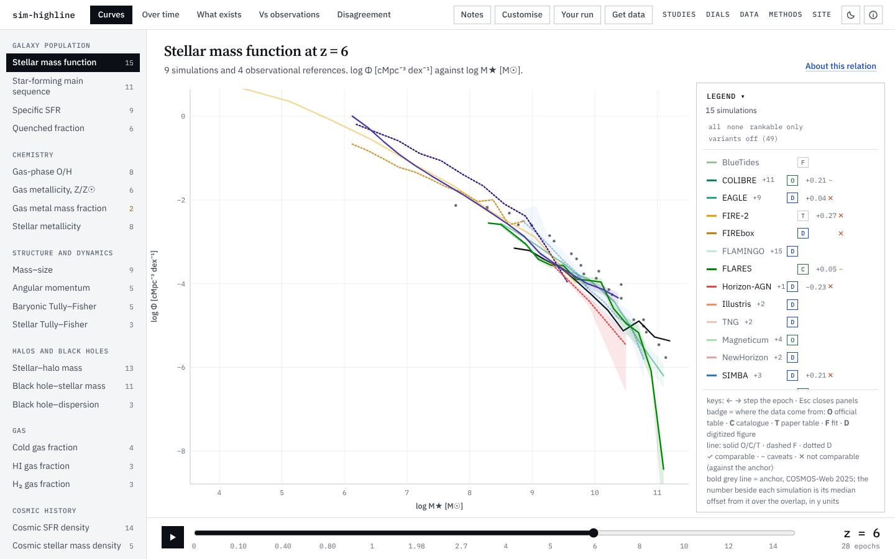

# sim-highline

[](https://doi.org/10.5281/zenodo.23217259)

<picture>
  <source media="(prefers-color-scheme: dark)" srcset="site/src/img/app-dark.png">
  
</picture>

**A curated dataset of galaxy scaling relations from cosmological simulations, an instrument for retuning two feedback models against each other, and five pre-registered studies of how far simulated galaxy populations can and cannot be made to agree.**

> **Beta, not reviewed by anyone outside the project.** More than half of the simulation curves (54 %) were read from published figures by script; every record carries its source, definitions and evidence tier, but **no record has been checked by an outside expert yet**. Where an author or collaboration publishes its own table, use that. Some records come from third-party releases with their own terms (`terms` column; `docs/SOURCE-TERMS.md`).
>
> **Corrections and takedowns:** if you are an author or data owner and want a record corrected, attributed differently or removed, open an issue (the "Curve error" form) or use the contact in `CITATION.cff`. Requests are handled promptly and removal is not contested.

**Live:** [Explorer](https://shubhanbhatia42.github.io/sim-highline/highline.html) · [Retune](https://shubhanbhatia42.github.io/sim-highline/site/retune.html) · [Studies](https://shubhanbhatia42.github.io/sim-highline/site/studies.html) · [Data](https://shubhanbhatia42.github.io/sim-highline/site/data.html) · [Methods](https://shubhanbhatia42.github.io/sim-highline/site/methods.html) · [dataset files](https://shubhanbhatia42.github.io/sim-highline/data/export/)

## What it is

| | |
|---|---|
| **Dataset** | Curves from simulations and observations (counts: `data/coverage-report.json`): scaling relations (stellar mass function, star-forming main sequence, mass-metallicity, black hole mass, sizes, gas fractions, quenched fractions, cosmic densities and more) from simulations and observations, each with its native axis definitions, mass definition, IMF, population cut, interval semantics, evidence tier and citation. CC BY 4.0. |
| **Explorer** | Draws only ingested evidence. A missing epoch stays missing, incompatible definitions stay visible as mismatches, and nothing is synthesised from a template. Views: Curves, Over time, What exists, Vs observations, Disagreement, and *Your run* (paste your own curve, declare its definitions, get a definition-aware comparison with every published curve at the epoch; stays in the browser). |
| **Dials** (the "Retune" instrument) | In-browser emulators of 2,054 CAMELS simulations (IllustrisTNG and SIMBA, 1,000 Latin-hypercube runs each, four feedback dials per code): move a dial and 11 galaxy observables respond; ask whether the other model can be made to match; see which observables resist. |
| **Studies** | Five analyses with the rule fixed before the data were looked at, the power of the test measured on synthetic worlds, and null results reported as such. |

## What it has found so far

| study | question | result |
|---|---|---|
| **How much is just definitions?** | Do simulations that share documented definitions agree better? | Only 4 % of the cross-suite pairs in this dataset have fully matched documented definitions (58 % have a documented mismatch, 21 % cannot be classified); after correction for multiple tests the data neither show nor rule out that definitions explain the disagreement. [analysis](docs/ANALYSIS-definition-budget.md) |
| **Can matching definitions close the gap?** | How much of the spread between simulated z ~ 0 stellar mass functions do documented definitions (IMF, scatter, aperture) explain? | Not detected (R = 0.15, interval -1.04 to 0.51, permutation p = 0.11); the power study shows aperture effects of the measured size could not have been seen with 8 suites. [protocol](docs/PROTOCOL-harmonization.md), [analysis](docs/ANALYSIS-harmonization.md) |
| **What can retuning change in cosmic star formation?** | What can retuning change in the cosmic star formation history, and what does model form force? | No funnel of disagreement at z = 5 to 7.5 in published runs; retuning four feedback parameters brings TNG and SIMBA within the seed-to-seed scatter (0.08 against 0.13 dex), best match at the parameter edge; one validation fails marginally. [protocol](docs/PROTOCOL-model-form.md), [analysis](docs/ANALYSIS-model-form.md), [power](docs/POWER-model-form.md) |
| **Can two universes agree on everything at once?** | Can retuning make TNG and SIMBA agree on all galaxy observables at once? | **No: 4.8 noise units apart** (6.3 at the fiducial parameters; margin 1). Black hole occupation and gas metallicity stay structural even when fitted alone; the stellar mass function, quenched fraction, SFR density, gas fraction, sizes and black hole mass can each be matched alone, so the usual calibration targets do not tell the two codes apart. Not carried by one family: leaving out any one leaves 3.7 to 5.2. [protocol](docs/PROTOCOL-joint-reachability.md), [analysis](docs/ANALYSIS-joint-reachability.md), [calibration](docs/POWER-joint-reachability.md) |
| **Does the shape of star formation tell the codes apart?** | Do the share of galaxies in the green valley and the width of the star-forming sequence separate TNG and SIMBA beyond the quenched fraction and the main sequence? | **Not found.** The shape alone is removable (retuning brings the two within the scatter between runs); adding it to the quenched fraction and the main sequence, or to the joint set, adds no detectable separation. Two of the four checks set in advance did not hold (the emulators of these outputs are noisy; the search is unstable with few random starts), so the power is limited: no extra difference was found, not shown that there is none. Internal; no outside expert has reviewed it. |

The all-at-once study's protocol, its code and its calibration on synthetic worlds with known truth (27 runs: 0 of 17 with a true distance below 0.95 were called structural, 8 of 8 above 1.1) were committed before the result existed; one amendment (A1), written after an internal review and before the run, replaced the distance estimator by one that removes the emulators' own error. Every study page states what was and was not tested.

After the registered run, the all-at-once result was pressed harder and **held**: a second implementation of the distance gave 4.85 (registered 4.85), a different kind of emulator 4.91, other weightings 3.8 to 5.4; a third code, Astrid, shows black hole occupation separates SIMBA from both others. It also depends on resolution: without the two lowest mass bins 4.8 becomes 2.5. See [`docs/ROBUSTNESS-joint-reachability.md`](docs/ROBUSTNESS-joint-reachability.md), [`docs/CHOICES-joint-reachability.md`](docs/CHOICES-joint-reachability.md), [`docs/SCEPTIC.md`](docs/SCEPTIC.md) and the draft [`docs/RESEARCH-NOTE.md`](docs/RESEARCH-NOTE.md). The project on one printed page: [`site/summary.html`](https://shubhanbhatia42.github.io/sim-highline/site/summary.html). An honest account of the state of the project, and what a decision to continue should rest on: [`docs/RETROSPECTIVE.md`](docs/RETROSPECTIVE.md), [`docs/REVIEW-DAY.md`](docs/REVIEW-DAY.md), [`docs/ROADMAP.md`](docs/ROADMAP.md).

## Quick start

```bash
git clone https://github.com/ShubhanBhatia42/sim-highline && cd sim-highline
./scripts/verify-all.sh                    # builds and tests everything (the all-at-once analysis itself is not rerun)
python3 -m http.server -d dist             # then open http://localhost:8000/
```

`dist/highline.html` is the Explorer, `dist/site/` the project site (Retune, Studies, Data, Methods). `dist/` is generated and not committed.

Python: `pip install .` installs `sim_highline` with the dataset bundled (usage under *Getting the data* below).

## Reproducing the studies

| study | command | time |
|---|---|---|
| definitions | `python3 scripts/analyze_definition_budget.py` | seconds |
| matching definitions | `python3 scripts/analyze_harmonization.py` | a minute |
| cosmic star formation | `python3 scripts/ingest_camels_sfrd.py`; `python3 scripts/analyze_model_form.py` | ~20 min |
| all at once | `python3 scripts/ingest_camels_galaxies.py` (range reads of the public CAMELS catalogues); `python3 scripts/analyze_joint_reachability.py`; `python3 scripts/export_retune_data.py` | ~35 min; ~1 h; seconds |
| calibration | `python3 scripts/power_model_form.py`; `python3 scripts/power_joint_reachability.py` | 10 min; ~1.75 h |

| after the run | `./scripts/reproduce.sh` (add `full` to re-run the two registered analyses; then `git diff --stat data/analysis` must be empty) | ~10 min; +1 h 20 min |

Python packages for these: [`requirements-analysis.txt`](requirements-analysis.txt) to re-run the analyses, [`requirements-ingest.txt`](requirements-ingest.txt) to rebuild the catalogues, and [`requirements-lock.txt`](requirements-lock.txt) / [`environment.yml`](environment.yml) for the exact versions that produced the numbers.

`FULL=1 ./scripts/verify-all.sh` reruns the cosmic star formation analysis; the tests of every analysis check that its saved output is not stale. Adding sources from your own machine (TNG, EAGLE, FLAMINGO, COLIBRE, any Subfind run): [`docs/EXPANDING-COVERAGE.md`](docs/EXPANDING-COVERAGE.md).

## Data contract

Versioned records in `data/curves/` preserve:

- exact epoch or observational redshift bin;
- native axis definitions and units;
- population and selection warnings;
- interval semantics;
- evidence tier, citation, source URL and retrieval date;
- calibration role and rankability;
- `intervalKind` for point data: `uncertainty` (enters sigma), `scatter` (population spread, never enters sigma) or `unspecified`;
- structured `definitions` (mass definition, IMF, cosmology, population, SFR timescale, tracer conventions), maintained in `scripts/definitions.mjs`.

The interface separates plotted context from rankable comparisons. Comparability is judged per pair in `compare.js`: a record-level `rankable: false` vetoes any comparison, relation-specific hard keys (e.g. IMF and density frame for the GSMF, IMF and population for the SFMS) must match, and soft keys (mass definition, cosmology, SFR timescale) are reported as caveats with their expected magnitude where known. The user selects the observational reference explicitly. Residual statistics (median offset, RMS, mean |residual|/sigma) require at least three overlapping bins; sigma combines both reported uncertainties and is omitted when either side only reports intrinsic scatter.

## Rebuild and verify

The THESAN ingester expects the four official relation files in a source directory:

```bash
node scripts/ingest-thesan.mjs /private/tmp
node scripts/ingest-magneticum.mjs /private/tmp/magneticum/data
node scripts/ingest-cosmosweb.mjs /private/tmp/cosmosweb-smf.ecsv
node scripts/validate-curves.mjs
python3 scripts/ingest_comparison_data.py /path/to/velociraptor-comparison-data   # after running its convert.sh
python3 scripts/ingest_colibre_mzr.py /path/to/colibre_mzr_sharda26
node scripts/curate-vanderwel14.mjs
node scripts/annotate-definitions.mjs
node scripts/test-curves.mjs
node scripts/test-compare.mjs
node scripts/validate-manifest.mjs
node scripts/report-coverage.mjs
node scripts/build-static.mjs
node scripts/test-static.mjs
```

`test-curves.mjs` checks more than file shape: it guards against rigid-offset redshift evolution, reversed high-redshift abundance evolution, lost source hashes, and accidental ranking of incompatible native definitions.

Build with `./scripts/verify-all.sh` (or the three scripts `build-static.mjs`, `build-highline.mjs`, `build-site.mjs`), then serve `dist/` with any static file server, for example `python3 -m http.server -d dist`. `dist/site/index.html` is the front page of the project site and `dist/highline.html` the Explorer app; `dist/` is generated and not committed.

## Getting the data

The beta page (`dist/highline.html`) has a Get data panel that downloads exactly what is plotted, or all epochs, as tidy CSV or JSON, with a copy-ready Python snippet and BibTeX. The whole dataset is in `data/export/` (`sim-highline-records.csv`, `sim-highline-points.csv`, `sim-highline-records.json`, `sim-highline-citations.bib`, `sim-highline-manifest.json`), and `sim_highline.py` loads it:

```python
import sim_highline
df = sim_highline.load()
sel = sim_highline.select(df, relation="sfms", z=(1, 2), sources=["EAGLE", "IllustrisTNG"], rankable=True)
one = sim_highline.nearest_epoch(sel, z=1.5)        # nearest published epoch per run; nothing is interpolated
x, y, lo, hi = sim_highline.curve(df, one.record_id.iloc[0])
print(sim_highline.bibtex(sel))
```

Units are log10, physical and h-free as published (no simulation curve is converted for IMF, aperture or cosmology; what was changed is listed in [docs/DATA-CHANGES.md](docs/DATA-CHANGES.md)); compare curves only where `x_definition`, `y_definition`, `mass_definition`, `population` and the other definition columns agree.

### Compare your own curve in Python

```python
import sim_highline
df = sim_highline.load()
out = sim_highline.compare_run(x, y, "gsmf", z=0.1, sigma=err,
        definitions={"imf": "chabrier03", "massDefinition": "aperture-50pkpc", "densityFrame": "comoving"}, df=df)
```

One row per published curve at that epoch: definition verdict and reasons (the same rules as the website, exported in `sim-highline-rules.json` and checked against the JavaScript by a parity test), and the median, mean and rms offset of your curve in the relation's y units. Undeclared definitions can never be called comparable.

## Install and cite

```
pip install .            # from a checkout: installs sim_highline with the dataset bundled
```

A wheel built with `pip wheel .` contains `sim_highline.py` and the exported tables (`sim_highline_data/`), so `import sim_highline; sim_highline.load()` works from any folder. `notebooks/quickstart.ipynb` walks through loading, selecting an epoch, plotting against observations and getting BibTeX.

Code is MIT (`LICENSE`), the dataset is CC BY 4.0 (`LICENSE-DATA.md`); inputs from third-party releases keep their own terms (`docs/SOURCE-TERMS.md`). Cite the dataset (DOI [10.5281/zenodo.23217259](https://doi.org/10.5281/zenodo.23217259), always the latest version; `CITATION.cff`, or the Cite box in the beta's Get data panel) together with the original paper of every record you use.

## Embed a view

In the beta, Get data > Figure > Copy embed code gives an `<iframe>` for the current view. Any link can also be turned into an embed by adding `&embed=1` to the page link: the page then shows only the chart, legend and epoch slider with a link back to the full app.

## Contributing and checks

`.github/` holds issue forms (curve error, suggest a source), a pull request checklist and two workflows: `verify` runs `scripts/verify-all.sh` on pull requests and fails if regenerated files were not committed; `watch-arxiv` runs weekly and opens an issue listing new papers that mention a tracked simulation suite (`scripts/watch-arxiv.py`, optional `--scan` to read their captions with `scripts/scan_literature.py`). See `CONTRIBUTING.md`.

## More

`docs/REVIEW.md` (a candid assessment: who would use this, what it is not), `docs/METHODS.md` (how values get in and what they may mean), `docs/DATA-CARD.md`, `docs/expert-audit-sample.md`, `CHANGELOG.md`, `CITATION.cff`. Verify everything with `./scripts/verify-all.sh`; `python3 scripts/regress_digitizers.py` regenerates every digitized record from its source and diffs against the shipped data.
